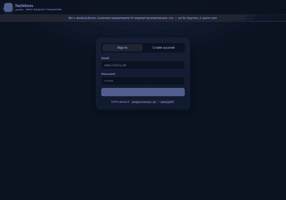
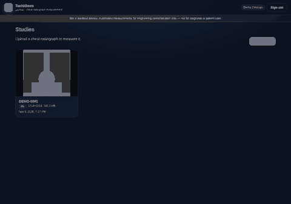
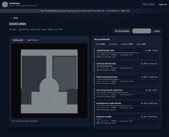
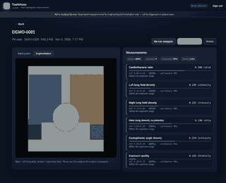
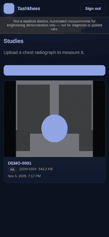

# Tashkhees

**AI-assisted chest radiograph measurement and reporting.**

Tashkhees (تشخیص — *diagnosis* in Urdu) takes a chest X-ray, measures a set of explicit
radiographic features from the actual pixels, flags the ones outside reference ranges, and
drafts a structured report. Every number in that report traces back to a measurement you can
reproduce.

> ⚠️ **Not a medical device.** Tashkhees is an engineering demonstration. It has not been
> validated for clinical use and must not be used to diagnose, treat, or manage any patient.

---

## Why this exists

Most "AI diagnosis" demos are a black box: an image goes in, a confident-sounding label comes
out, and nothing in between is inspectable. That is the opposite of what medical software
should be.

Tashkhees takes the other road. The default engine is a **deterministic measurement engine**,
not a trained diagnostic network. It computes the cardiothoracic ratio the same way a
radiologist does with a ruler — widest cardiac silhouette over thoracic width — and reports
the number, the reference range, and how far outside it sits. If it can't measure something
reliably, it says so instead of guessing.

The engine sits behind a provider interface, so a real trained model can be dropped in later
without touching the API, the database, or the UI.

---

## Features

- **Real measurements, not scores** — cardiothoracic ratio, left/right lung field density,
  inter-lung asymmetry, costophrenic angle density, exposure quality.
- **Reference ranges on every finding** — each measurement carries its expected interval and
  a plain-language note explaining what a breach means.
- **Honest confidence** — derived from image quality and distance from the reference boundary,
  not invented. A noisy film produces low-confidence findings.
- **Segmentation overlay** — see exactly which lung fields the engine measured, in the browser.
- **Structured reports** — technique, findings, impression, and a mandatory disclaimer that
  cannot be omitted.
- **JWT auth with bcrypt** — 12 rounds, rate-limited login, no password ever logged.
- **Mobile-first UI** — works on a phone at the bedside, no build step, no framework.
- **88 tests** — engine, API, auth, reports, rate limiter. Ruff and black clean.

---

## Screenshots

| Sign in | Dashboard |
|---|---|
|  |  |

| Analysis — measurements | Segmentation overlay |
|---|---|
|  |  |

| Structured report | Mobile |
|---|---|
|  |  |

---

## Live demo

**Deployment status:** no live URL is claimed. The sandbox this was built in has no
`VERCEL_TOKEN`, so the deploy step could not be run. The repository ships a working
`vercel.json` and `api/index.py` entrypoint — see [Deploying](#deploying) for the exact
commands. The production build and the full test suite were verified locally.

---

## Quick start

```bash
git clone https://github.com/mohdabrarbaloch-arch/day-12-tashkhees.git
cd day-12-tashkhees

python3 -m venv .venv && source .venv/bin/activate
pip install -e ".[dev]"

cp .env.example .env          # then edit SECRET_KEY
python scripts/seed.py        # creates the demo account + a sample study

uvicorn app.main:app --reload --port 8012
```

Open <http://127.0.0.1:8012> and sign in with `demo@tashkhees.pk` / `demo12345`.

API docs are at <http://127.0.0.1:8012/docs>.

---

## Docker

```bash
docker compose up --build
```

That brings up the app on port 8012 and a PostgreSQL 16 instance. Set `DATABASE_URL` in
`.env` to point at Postgres (the compose file does this for you).

---

## Deploying

**Vercel** (serverless):

```bash
npm i -g vercel
vercel --prod --yes --token "$VERCEL_TOKEN"
```

Set `SECRET_KEY`, `ENVIRONMENT=production`, and `DATABASE_URL` in the Vercel project's
environment variables first. The app refuses to boot in production with the default secret.

**Any Docker host:**

```bash
docker build -t tashkhees .
docker run -p 8012:8012 --env-file .env tashkhees
```

---

## How the measurement works

| Measurement | Method | Reference | Flagged when |
|---|---|---|---|
| Cardiothoracic ratio | widest dense midline structure ÷ thorax width | < 0.50 | ≥ 0.50 |
| Left lung density | mean intensity in the left lung mask | 0.15 – 0.55 | outside |
| Right lung density | mean intensity in the right lung mask | 0.15 – 0.55 | outside |
| Density asymmetry | \|L − R\| ÷ mean(L, R) | < 0.25 | ≥ 0.25 |
| Costophrenic density | mean intensity in the bottom-lateral bands | < 0.45 | ≥ 0.45 |
| Exposure quality | mean intensity + dynamic range | 0.25 – 0.75 | outside |

The full method — including how the lung fields are segmented and how confidence is derived —
is in [`ARCHITECTURE.md`](ARCHITECTURE.md) and the docstrings in `app/engine/imaging.py`.

---

## Project layout

```
app/
  engine/       imaging.py (pixel math) · analyze.py (ranges, confidence) · report.py
  routers/      auth · studies · analysis · reports · health
  static/       index.html · app.js · styles.css
  main.py       app factory, middleware, error handlers
  models.py     User · Study · Analysis · Finding · Report
tests/          88 tests across engine, API, auth, reports, rate limiting
docs/           setup.md · usage.md · api.md
```

---

## Testing

```bash
pytest              # 88 tests
ruff check .        # lint
black --check .     # format
```

---

## License

MIT — see [LICENSE](LICENSE).

---

## A note on honesty

This project deliberately does **not** claim to detect pneumonia, nodules, or any specific
pathology from a learned model, because shipping a fake "AI diagnosis" would be dishonest and
potentially harmful. What it does claim — that it measures the cardiothoracic ratio and lung
field densities from real pixels, and reports them with their reference ranges — it actually
does, and you can verify every number in the test suite.
